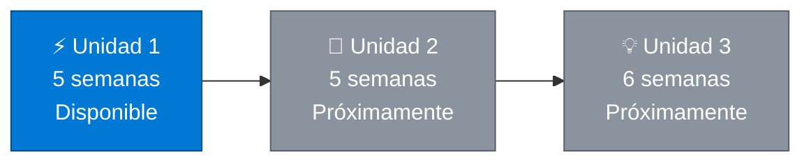

  

UNIVERSIDAD NACIONAL DE LOJA · INGENIERÍA EN COMPUTACIÓN

# 📓 CUADERNO DE APUNTES 📓

## ⚡ Diseño de Circuitos ⚡

⚪━━━━━⚪━━━━━⚪━━━━━⚪━━━━━⚪━━━━━⚪━━━━━⚪

---

### 🏷️ Ficha del cuaderno

| | |
|:---:|---|
| 🏛️ **Institución** | Universidad Nacional de Loja |
| 🏢 **Facultad** | Facultad de la Energía, las Industrias y los Recursos Naturales No Renovables |
| 💻 **Carrera** | Ingeniería en Computación |
| ⚡ **Asignatura** | Diseño de Circuitos — Segundo ciclo |
| 👨‍🎓 **Estudiante** | Manuel Alejandro Ponce Armijos |
| 👩‍🏫 **Docente** | Ing. Lissette Geoconda López Faicán |
| 📅 **Período académico** | Septiembre 2026 – marzo 2027 |
| 📍 **Lugar** | Loja, Ecuador |

---

## ✍️ Sobre este cuaderno

> [!NOTE]
> Este cuaderno reúne mis **apuntes teóricos y ejercicios resueltos a mano** de la asignatura Diseño de Circuitos. Está organizado por **unidades** y, dentro de cada una, por **semanas**: cada semana trata un tema, con su definición, ideas clave, fórmulas, un ejemplo resuelto paso a paso y un recuadro «Recuerda» para repasar rápidamente.

---

## 📚 Unidades

<table>
  <tr>
    <td align="center" width="33%">
      <h3>⚡ Unidad 1</h3>
      <b>Fundamentos de la Electrónica Digital</b>  
       
        
      
    </td>
    <td align="center" width="33%">
      <h3>🔌 Unidad 2</h3>
      <b>Próximamente</b>  
       
        
      
    </td>
    <td align="center" width="33%">
      <h3>💡 Unidad 3</h3>
      <b>Próximamente</b>  
       
        
      
    </td>
  </tr>
</table>

<b>📂 ⚡ Unidad 1 · Fundamentos de la Electrónica Digital (5 semanas)</b>

 

| Semana | Tema |
|:---:|---|
| 🔌 1 | Transistores |
| 🧮 2 | Álgebra de Boole y mapas de Karnaugh de tres y cuatro variables |
| 🧩 3 | Formas canónicas, teoremas y leyes de De Morgan, simplificación algebraica |
| 📋 4 | Suma de productos y producto de sumas, minitérminos y maxitérminos |
| ➕ 5 | Bloques combinacionales aritméticos |

  

<b>📂 🔌 Unidad 2 · Próximamente (5 semanas)</b>

 

Los apuntes de esta unidad se añadirán a medida que avance el ciclo.

<b>📂 💡 Unidad 3 · Próximamente (6 semanas)</b>

 

Los apuntes de esta unidad se añadirán a medida que avance el ciclo.

---

## 🎓 Conclusiones del Aprendizaje

### ⚡ Unidad 1

En la **Unidad 1** comprendí cómo el **transistor BJT**, trabajando entre corte y saturación, permite representar los valores lógicos 0 y 1. A partir de ellos estudié el **álgebra de Boole**, sus teoremas y las **leyes de De Morgan**, que sirven para escribir y simplificar funciones lógicas, y apliqué los **mapas de Karnaugh** de tres y cuatro variables como método gráfico de simplificación. Aprendí a pasar de una tabla de verdad a su **forma canónica** mediante **minitérminos y maxitérminos**, y a expresarla como suma de productos o producto de sumas. Finalmente, integré estos conocimientos en el diseño de **bloques aritméticos** —semisumador, sumador completo, sumador de 4 bits y restador con complemento a 2—, que constituyen la base de la unidad aritmética de un computador.

### 🔌 Unidad 2

*Se redactará al finalizar la unidad.*

### 💡 Unidad 3

*Se redactará al finalizar la unidad.*

---

<b>📚 Bibliografía (formato IEEE)</b>

 

[1] M. M. Mano y M. D. Ciletti, *Digital Design: With an Introduction to the Verilog HDL, VHDL, and SystemVerilog*, 6.ª ed. Hoboken, NJ, EE. UU. (verificar): Pearson, 2018.

[2] T. L. Floyd, *Fundamentos de sistemas digitales*, 9.ª ed. Madrid, España: Pearson Educación, 2006.

[3] R. L. Boylestad y L. Nashelsky, *Electrónica: teoría de circuitos y dispositivos electrónicos*, 10.ª ed. México: Pearson Educación, 2009.

[4] A. S. Sedra y K. C. Smith, *Microelectronic Circuits*, 7.ª ed. Nueva York, NY, EE. UU.: Oxford University Press, 2015.

<b>🤖 Declaración de Uso de Inteligencia Artificial Generativa</b>

 

En la elaboración de este cuaderno se utilizó **Claude** (Anthropic) como herramienta de apoyo.

- **🎯 Finalidad:** se utilizó para consultar y explicar los temas de la asignatura, estructurar el cuaderno en unidades y semanas, y corregir el estilo de la redacción.
- **🧠 Supervisión humana:** el estudiante revisó el contenido generado, comprobó los ejemplos, tablas de verdad y cálculos, y realizó los ajustes necesarios.
- **📚 Ética académica:** la herramienta se empleó como apoyo al estudio, sin sustituir el aprendizaje ni la comprensión de los conceptos.
- **⚖️ Limitaciones:** se tuvo en cuenta que la inteligencia artificial puede generar información incorrecta, por lo que los resultados se contrastaron con la bibliografía.
- **🔒 Responsabilidad:** el estudiante es responsable de la exactitud del contenido y de la autenticidad del trabajo presentado.
- **🌐 Transparencia:** el uso de esta herramienta se declara en esta sección de acuerdo con las indicaciones de la docente.

---

⚪━━━━━⚪━━━━━⚪━━━━━⚪━━━━━⚪━━━━━⚪━━━━━⚪

⚡ **APUNTES · LÓGICA · DISEÑO · CIRCUITOS** ⚡

📍 *Loja, Ecuador · Septiembre 2026 – marzo 2027*

