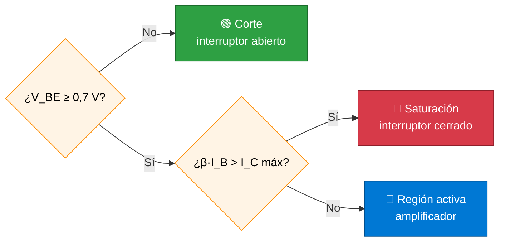

<div align="center">

<sub>📓 CUADERNO DE APUNTES · DISEÑO DE CIRCUITOS · SEGUNDO CICLO</sub>

# ⚡ UNIDAD 1 ⚡

## 🔌 Fundamentos de la Electrónica Digital 💡


<sub>Manuel Alejandro Ponce Armijos · Universidad Nacional de Loja · Septiembre 2026 – marzo 2027</sub>

</div>

---

<a id="indice"></a>

## 📑 Índice

| Semana | Tema | Resumen | Ir |
|:---:|---|---|:---:|
| 1 | Transistores BJT | El transistor NPN como interruptor: corte, región activa y saturación. | [▶️ Semana 1](#semana-1) |
| 2 | Álgebra de Boole y mapas de Karnaugh | Postulados de Boole y simplificación gráfica con mapas de 3 y 4 variables. | [▶️ Semana 2](#semana-2) |
| 3 | Formas canónicas, De Morgan y simplificación | Teoremas, leyes de De Morgan y reducción algebraica paso a paso. | [▶️ Semana 3](#semana-3) |
| 4 | SOP, POS, minitérminos y maxitérminos | Expresar una función desde su tabla de verdad en Σm y ΠM. | [▶️ Semana 4](#semana-4) |
| — | Conclusión de la unidad | Síntesis de lo aprendido. | [▶️ Conclusión](#conclusion) |

### 🗺️ Ruta de la unidad


> [!TIP]
> 💡 **Tip:** cada semana está plegada. Haz clic en **«Ver apuntes»** para desplegarla.

---

<a id="semana-1"></a>

## 🔌 Semana 1 · Transistores BJT

<p align="center">
  
  
</p>

<details>
<summary><b>📖 Ver apuntes de la Semana 1</b></summary>

### 📌 Definición

El **transistor bipolar de unión (BJT)** es un dispositivo semiconductor de tres terminales (**base**, **colector** y **emisor**) formado por dos uniones PN. En el tipo **NPN**, una corriente pequeña en la base controla una corriente mucho mayor entre colector y emisor.

```text
            C (colector)
            |
          |/
   B ─────|        NPN: la flecha del emisor
          |\>      apunta hacia afuera
            |
            E (emisor)
```

### 🔑 Ideas clave y fórmulas

$$I_E = I_C + I_B \qquad I_C = \beta \cdot I_B \ \text{(solo en región activa)} \qquad V_{BE} \approx 0{,}7\ \text{V (silicio)}$$

| Región | Unión B‑E | Unión B‑C | Condición | Comportamiento |
|---|---|---|---|---|
| 🟢 **Corte** | Sin conducir ($V_{BE} < 0{,}7$ V) | Inversa | $I_B \approx 0$ | $I_C \approx 0$, $V_{CE} \approx V_{CC}$ → **interruptor abierto** |
| 🔵 **Activa** | Directa | Inversa | $I_C = \beta I_B$ | Amplificador |
| 🔴 **Saturación** | Directa | Directa | $\beta I_B > I_C$ | $V_{CE(sat)} \approx 0{,}2$ V → **interruptor cerrado** |



> 💡 **Tip:** en electrónica digital el transistor trabaja solo en **corte** (0 lógico) y **saturación** (1 lógico); la región activa se usa en amplificadores.

### ✏️ Ejemplo resuelto: encender un LED con un NPN

```text
          +5 V
            |
          [R_C]
            |
           LED ▼
            |
            C
 V_in ─[R_B]─B   Q1 (NPN)
            E
            |
           GND
```

**Datos del enunciado:** $V_{CC} = V_{in} = 5$ V · LED rojo $V_{LED} = 2$ V · corriente deseada $I_C = 10$ mA · $V_{CE(sat)} = 0{,}2$ V · $V_{BE} = 0{,}7$ V · $\beta_{min} = 100$ (por ejemplo, 2N3904).

**Paso 1 — Resistencia de colector.** Por la malla colector‑emisor:

$$R_C = \frac{V_{CC} - V_{LED} - V_{CE(sat)}}{I_C} = \frac{5 - 2 - 0{,}2}{0{,}010} = 280\ \Omega \ \Rightarrow\ \textbf{330 Ω (comercial)}$$

**Paso 2 — Corriente real de colector** con el valor comercial:

$$I_C = \frac{2{,}8}{330} \approx 8{,}5\ \text{mA}$$

**Paso 3 — Corriente de base.** Para asegurar saturación se usa una ganancia forzada $\beta_f = 10$:

$$I_B = \frac{I_C}{\beta_f} = \frac{8{,}5\ \text{mA}}{10} = 0{,}85\ \text{mA}$$

**Paso 4 — Resistencia de base:**

$$R_B = \frac{V_{in} - V_{BE}}{I_B} = \frac{5 - 0{,}7}{0{,}00085} \approx 5{,}06\ \text{k}\Omega \ \Rightarrow\ \textbf{4,7 kΩ (comercial)}$$

Se elige el valor comercial **inferior** para que la corriente de base sea algo mayor y la saturación quede garantizada.

**Paso 5 — Comprobación de saturación:**

$$I_B = \frac{4{,}3}{4700} \approx 0{,}91\ \text{mA} \qquad \beta_{min} I_B = 100 \times 0{,}91\ \text{mA} \approx 91\ \text{mA} \gg 8{,}5\ \text{mA} \ ✅$$

| $V_{in}$ | Región | LED |
|:---:|:---:|:---:|
| 0 V | Corte | Apagado |
| 5 V | Saturación | Encendido (≈ 8,5 mA) |

> ⚠️ **Cuidado:** sin $R_B$ la unión base‑emisor recibe una corriente excesiva y el transistor puede dañarse; sin $R_C$ el LED se quema.

> 📌 **Recuerda**
> - NPN: conduce cuando la base es ≈ 0,7 V más positiva que el emisor.
> - Interruptor = corte ↔ saturación. Amplificador = región activa.
> - Diseña con $\beta_f \approx 10$ y redondea $R_B$ hacia abajo para asegurar saturación.

</details>

<p align="center">
  <a href="./Portada.md"></a>
  <a href="#indice"></a>
  <a href="#semana-2"></a>
</p>

---

<a id="semana-2"></a>

## 🧮 Semana 2 · Álgebra de Boole y mapas de Karnaugh

<p align="center">
  
  
</p>

<details>
<summary><b>📖 Ver apuntes de la Semana 2</b></summary>

### 📌 Definición

El **álgebra de Boole** trabaja con variables que solo toman los valores **0** y **1**, y con tres operaciones: **AND** ($\cdot$), **OR** ($+$) y **NOT** ($\overline{A}$). Orden de precedencia: NOT → AND → OR.

### 🔑 Postulados y propiedades básicas

| Propiedad | Forma OR | Forma AND (dual) |
|---|---|---|
| Identidad | $A + 0 = A$ | $A \cdot 1 = A$ |
| Elemento nulo | $A + 1 = 1$ | $A \cdot 0 = 0$ |
| Idempotencia | $A + A = A$ | $A \cdot A = A$ |
| Complemento | $A + \overline{A} = 1$ | $A \cdot \overline{A} = 0$ |
| Involución | $\overline{\overline{A}} = A$ | — |
| Conmutativa | $A + B = B + A$ | $AB = BA$ |
| Asociativa | $A + (B + C) = (A + B) + C$ | $A(BC) = (AB)C$ |
| Distributiva | $A + BC = (A + B)(A + C)$ | $A(B + C) = AB + AC$ |

> 💡 **Principio de dualidad:** si una igualdad es válida, también lo es su dual, que se obtiene intercambiando $+ \leftrightarrow \cdot$ y $0 \leftrightarrow 1$.

### 🗺️ Mapas de Karnaugh

Un **mapa de Karnaugh (K‑map)** es una tabla de verdad reordenada en **código Gray** (00, 01, 11, 10), de modo que dos celdas vecinas difieren en una sola variable. Agrupar unos vecinos elimina la variable que cambia.

**Reglas de agrupación**

1. Grupos de 1, 2, 4, 8 o 16 celdas (potencias de 2), en forma rectangular.
2. Los grupos deben ser **lo más grandes posible** y **los menos posibles**.
3. Los bordes son adyacentes: el mapa «se dobla» (izquierda ↔ derecha, arriba ↔ abajo; las cuatro esquinas forman un grupo).
4. Una celda puede pertenecer a varios grupos.
5. Las condiciones indiferentes ($X$) pueden usarse como 1 si agrandan un grupo.

En cada grupo **se conservan solo las variables que no cambian**: con valor 1 aparecen sin complemento y con valor 0, complementadas.

### ✏️ Ejemplo 1 — Mapa de 3 variables

Simplificar $F(A,B,C) = \sum m(0, 2, 4, 5, 6)$ *(la notación $\sum m$ se detalla en la Semana 4: indica las filas de la tabla de verdad donde $F = 1$).*

| $A \backslash BC$ | **00** | **01** | **11** | **10** |
|:---:|:---:|:---:|:---:|:---:|
| **0** | 1 🟦 | 0 | 0 | 1 🟦 |
| **1** | 1 🟦🟩 | 1 🟩 | 0 | 1 🟦 |

- 🟦 Grupo de 4 (columnas 00 y 10, unidas por el borde): $A$ y $B$ cambian, $C = 0$ → $\overline{C}$
- 🟩 Grupo de 2 (fila 1, columnas 00 y 01): $C$ cambia, $A = 1$, $B = 0$ → $A\overline{B}$

$$\boxed{F = \overline{C} + A\overline{B}}$$

### ✏️ Ejemplo 2 — Mapa de 4 variables

Simplificar $F(A,B,C,D) = \sum m(0, 1, 2, 5, 8, 9, 10)$.

| $AB \backslash CD$ | **00** | **01** | **11** | **10** |
|:---:|:---:|:---:|:---:|:---:|
| **00** | 1 🟦🟩 | 1 🟦🟥 | 0 | 1 🟩 |
| **01** | 0 | 1 🟥 | 0 | 0 |
| **11** | 0 | 0 | 0 | 0 |
| **10** | 1 🟦🟩 | 1 🟦 | 0 | 1 🟩 |

- 🟦 Filas 00 y 10 × columnas 00 y 01 (m0, m1, m8, m9): $B = 0$, $C = 0$ → $\overline{B}\,\overline{C}$
- 🟩 Las cuatro esquinas (m0, m2, m8, m10): $B = 0$, $D = 0$ → $\overline{B}\,\overline{D}$
- 🟥 Columna 01, filas 00 y 01 (m1, m5): $A = 0$, $C = 0$, $D = 1$ → $\overline{A}\,\overline{C}D$

$$\boxed{F = \overline{B}\,\overline{C} + \overline{B}\,\overline{D} + \overline{A}\,\overline{C}D}$$

> ⚠️ **Cuidado:** el orden de filas y columnas es **00, 01, 11, 10**, no el binario natural. Si usas 00, 01, 10, 11 los vecinos dejan de diferir en un solo bit y las agrupaciones son incorrectas.

> 📌 **Recuerda**
> - Grupo de $2^k$ celdas elimina $k$ variables.
> - Grupos grandes → términos cortos; pocos grupos → menos términos.
> - Las esquinas y los bordes opuestos son vecinos.

</details>

<p align="center">
  <a href="#semana-1"></a>
  <a href="#indice"></a>
  <a href="#semana-3"></a>
</p>

---

<a id="semana-3"></a>

## 🧩 Semana 3 · Formas canónicas, teoremas de De Morgan y simplificación algebraica

<p align="center">
  
  
</p>

<details>
<summary><b>📖 Ver apuntes de la Semana 3</b></summary>

### 📌 Teoremas para simplificar

| Teorema | Forma 1 | Forma 2 (dual) |
|---|---|---|
| Absorción | $A + AB = A$ | $A(A + B) = A$ |
| Absorción del complemento | $A + \overline{A}B = A + B$ | $A(\overline{A} + B) = AB$ |
| Consenso | $AB + \overline{A}C + BC = AB + \overline{A}C$ | $(A+B)(\overline{A}+C)(B+C) = (A+B)(\overline{A}+C)$ |

### 🔄 Leyes de De Morgan

$$\overline{A \cdot B} = \overline{A} + \overline{B} \qquad\qquad \overline{A + B} = \overline{A} \cdot \overline{B}$$

**Regla práctica:** «se rompe la barra y se cambia el signo». Se generaliza a $n$ variables: $\overline{A + B + C} = \overline{A}\,\overline{B}\,\overline{C}$.

**Comprobación con tabla de verdad**

| A | B | $\overline{A \cdot B}$ | $\overline{A} + \overline{B}$ | $\overline{A + B}$ | $\overline{A} \cdot \overline{B}$ |
|:---:|:---:|:---:|:---:|:---:|:---:|
| 0 | 0 | 1 | 1 | 1 | 1 |
| 0 | 1 | 1 | 1 | 0 | 0 |
| 1 | 0 | 1 | 1 | 0 | 0 |
| 1 | 1 | 0 | 0 | 0 | 0 |

Las columnas 3‑4 y 5‑6 coinciden en todas las filas: las leyes se cumplen. Consecuencia directa: una compuerta **NAND** equivale a una OR con entradas negadas, y una **NOR** a una AND con entradas negadas.

### ✏️ Ejemplo 1 — Simplificación algebraica

Simplificar $F = AB + A(B + C) + B(B + C)$.

| Paso | Expresión | Ley aplicada |
|:---:|---|---|
| 1 | $AB + AB + AC + BB + BC$ | Distributiva |
| 2 | $AB + AC + B + BC$ | Idempotencia ($AB + AB = AB$, $BB = B$) |
| 3 | $AB + AC + B$ | Absorción ($B + BC = B$) |
| 4 | $B + AC$ | Absorción ($B + AB = B$) |

$$\boxed{F = B + AC}$$

### ✏️ Ejemplo 2 — Aplicando De Morgan

Simplificar $F = \overline{(A + \overline{B})\,C}$.

$$F = \overline{A + \overline{B}} + \overline{C} \quad \text{(De Morgan sobre el producto)}$$

$$F = \overline{A}\,\overline{\overline{B}} + \overline{C} = \overline{A}B + \overline{C} \quad \text{(De Morgan sobre la suma e involución)}$$

### 📐 Formas canónicas

Una expresión está en **forma canónica** cuando **cada término contiene todas las variables** de la función, complementadas o no. Hay dos:

- **Suma canónica:** suma de productos completos (minitérminos).
- **Producto canónico:** producto de sumas completas (maxitérminos).

La forma canónica es **única** para cada función, por eso sirve para comparar funciones.

**Ejemplo 3 — Llevar a suma canónica** $F(A,B,C) = A + \overline{B}C$

A cada término se le multiplica $(X + \overline{X}) = 1$ por cada variable que le falte:

$$A = A(B + \overline{B})(C + \overline{C}) = ABC + AB\overline{C} + A\overline{B}C + A\overline{B}\,\overline{C}$$

$$\overline{B}C = \overline{B}C(A + \overline{A}) = A\overline{B}C + \overline{A}\,\overline{B}C$$

Se eliminan repetidos ($A\overline{B}C$ aparece dos veces):

$$\boxed{F = \overline{A}\,\overline{B}C + A\overline{B}\,\overline{C} + A\overline{B}C + AB\overline{C} + ABC}$$

> ⚠️ **Cuidado:** $\overline{AB} \neq \overline{A}\,\overline{B}$. La barra larga sobre un producto **no** se reparte sin cambiar el operador.

> 📌 **Recuerda**
> - De Morgan: rompe la barra, cambia el signo.
> - Cita la ley usada en cada paso de una simplificación.
> - Forma canónica = todas las variables en cada término; es única.

</details>

<p align="center">
  <a href="#semana-2"></a>
  <a href="#indice"></a>
  <a href="#semana-4"></a>
</p>

---

<a id="semana-4"></a>

## 📋 Semana 4 · Suma de productos, producto de sumas, minitérminos y maxitérminos

<p align="center">
  
  
</p>

<details>
<summary><b>📖 Ver apuntes de la Semana 4</b></summary>

### 📌 Definiciones

- **Suma de productos (SOP):** términos AND unidos por OR. Ej.: $AB + \overline{A}C$. Se implementa como **AND → OR** (o NAND‑NAND).
- **Producto de sumas (POS):** términos OR unidos por AND. Ej.: $(A + B)(\overline{A} + C)$. Se implementa como **OR → AND** (o NOR‑NOR).
- **Minitérmino $m_i$:** producto que contiene todas las variables; la variable va **negada si su bit es 0**. Vale 1 solo en la fila $i$.
- **Maxitérmino $M_i$:** suma que contiene todas las variables; la variable va **negada si su bit es 1**. Vale 0 solo en la fila $i$.

### 🔢 Tabla para 3 variables

| Fila $i$ | A B C | Minitérmino $m_i$ | Maxitérmino $M_i$ |
|:---:|:---:|:---:|:---:|
| 0 | 0 0 0 | $\overline{A}\,\overline{B}\,\overline{C}$ | $A + B + C$ |
| 1 | 0 0 1 | $\overline{A}\,\overline{B}C$ | $A + B + \overline{C}$ |
| 2 | 0 1 0 | $\overline{A}B\overline{C}$ | $A + \overline{B} + C$ |
| 3 | 0 1 1 | $\overline{A}BC$ | $A + \overline{B} + \overline{C}$ |
| 4 | 1 0 0 | $A\overline{B}\,\overline{C}$ | $\overline{A} + B + C$ |
| 5 | 1 0 1 | $A\overline{B}C$ | $\overline{A} + B + \overline{C}$ |
| 6 | 1 1 0 | $AB\overline{C}$ | $\overline{A} + \overline{B} + C$ |
| 7 | 1 1 1 | $ABC$ | $\overline{A} + \overline{B} + \overline{C}$ |

### 🔑 Relaciones clave

$$M_i = \overline{m_i} \qquad F = \sum m(\text{filas con } F=1) = \prod M(\text{filas con } F=0)$$

Los índices de $\sum m$ y de $\prod M$ son **complementarios**: entre ambos cubren todas las filas, sin repetirse.

### ✏️ Ejemplo resuelto — Función mayoría

$F(A,B,C) = 1$ cuando **al menos dos** entradas valen 1.

| Fila | A | B | C | F |
|:---:|:---:|:---:|:---:|:---:|
| 0 | 0 | 0 | 0 | 0 |
| 1 | 0 | 0 | 1 | 0 |
| 2 | 0 | 1 | 0 | 0 |
| 3 | 0 | 1 | 1 | **1** |
| 4 | 1 | 0 | 0 | 0 |
| 5 | 1 | 0 | 1 | **1** |
| 6 | 1 | 1 | 0 | **1** |
| 7 | 1 | 1 | 1 | **1** |

**Paso 1 — Notación compacta:**

$$F = \sum m(3, 5, 6, 7) = \prod M(0, 1, 2, 4)$$

**Paso 2 — SOP canónica** (minitérminos de las filas con 1):

$$F = \overline{A}BC + A\overline{B}C + AB\overline{C} + ABC$$

**Paso 3 — POS canónica** (maxitérminos de las filas con 0):

$$F = (A + B + C)(A + B + \overline{C})(A + \overline{B} + C)(\overline{A} + B + C)$$

**Paso 4 — Simplificación** con mapa de Karnaugh (agrupando los 1 para SOP y los 0 para POS):

| $A \backslash BC$ | **00** | **01** | **11** | **10** |
|:---:|:---:|:---:|:---:|:---:|
| **0** | 0 | 0 | 1 🟦 | 0 |
| **1** | 0 | 1 🟩 | 1 🟦🟩🟥 | 1 🟥 |

- 🟦 m3, m7 → $BC$ · 🟩 m5, m7 → $AC$ · 🟥 m6, m7 → $AB$

$$\boxed{F_{SOP} = AB + AC + BC} \qquad \boxed{F_{POS} = (A + B)(A + C)(B + C)}$$

Ambas expresiones dan la misma tabla de verdad.

```text
 SOP (AND → OR)                     POS (OR → AND)

 A,B ──[AND]──┐                     A,B ──[OR]──┐
 A,C ──[AND]──┼──[OR]── F           A,C ──[OR]──┼──[AND]── F
 B,C ──[AND]──┘                     B,C ──[OR]──┘
```

> 💡 **Tip:** usa SOP cuando la función tiene pocos 1 y POS cuando tiene pocos 0: así hay menos términos que escribir.

> ⚠️ **Cuidado:** en un maxitérmino la regla se invierte: bit **1** → variable **negada**. Es el error más frecuente.

> 📌 **Recuerda**
> - $m_i$ → producto, vale 1 en la fila $i$. $M_i$ → suma, vale 0 en la fila $i$.
> - $\sum m$ usa las filas con 1; $\prod M$ usa las filas con 0.
> - SOP ↔ AND‑OR ↔ NAND‑NAND · POS ↔ OR‑AND ↔ NOR‑NOR.

</details>

<p align="center">
  <a href="#semana-3"></a>
  <a href="#indice"></a>
  <a href="#conclusion"></a>
</p>

---

<a id="conclusion"></a>

## 🎯 Conclusión de la Unidad 1

La Unidad 1 recorre el camino desde el componente físico hasta la expresión lógica lista para implementarse. El **transistor BJT** trabajando entre corte y saturación explica cómo un circuito electrónico representa un 0 y un 1. Sobre esos dos valores, el **álgebra de Boole**, sus **teoremas** y las **leyes de De Morgan** permiten escribir y reducir funciones lógicas, mientras que los **mapas de Karnaugh** ofrecen un método gráfico y sistemático para obtener la expresión mínima. Finalmente, las **formas canónicas** y la notación de **minitérminos y maxitérminos** conectan directamente la tabla de verdad con una expresión SOP o POS lista para implementarse en un circuito digital.

<p align="center">
  <a href="#indice"></a>
</p>

---

<div align="center">

**⚡ BINARIO · BOOLE · KARNAUGH · DISEÑO DIGITAL ⚡**

*Cuaderno de Apuntes — Diseño de Circuitos | Segundo Ciclo*

<a href="./README.md"></a>
<a href="./Portada.md"></a>

<sub>📍 Loja, Ecuador · Universidad Nacional de Loja</sub>

</div>
