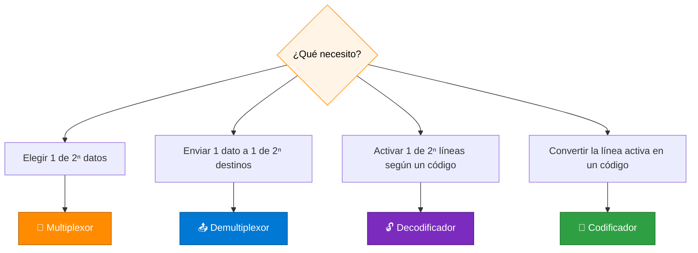

<div align="center">

<sub>📓 CUADERNO DE APUNTES · DISEÑO DE CIRCUITOS · SEGUNDO CICLO</sub>

# 🔌 UNIDAD 2 🔌

## ⚡ Circuitos Combinacionales ⚡


<sub>Manuel Alejandro Ponce Armijos · Universidad Nacional de Loja · Septiembre 2026 – marzo 2027</sub>

</div>

---

<a id="indice"></a>

## 📑 Índice

| Semana | Tema | Resumen | Ir |
|:---:|---|---|:---:|
| 1 | Multiplexores, demultiplexores, codificadores y decodificadores | Bloques combinacionales que seleccionan, reparten, activan y codifican señales. | [▶️ Semana 1](#semana-1) |
| 2 | Próximamente | Se añadirá a medida que avance el ciclo. | — |
| 3 | Próximamente | Se añadirá a medida que avance el ciclo. | — |
| 4 | Próximamente | Se añadirá a medida que avance el ciclo. | — |
| 5 | Próximamente | Se añadirá a medida que avance el ciclo. | — |

> [!TIP]
> 💡 **Tip:** cada semana está plegada. Haz clic en **«Ver apuntes»** para desplegarla.

---

<a id="semana-1"></a>

## 🔀 Semana 1 · Multiplexores, demultiplexores, codificadores y decodificadores

<p align="center">
  
  
</p>

<details>
<summary><b>📖 Ver apuntes de la Semana 1</b></summary>

### 📌 Definición

Un **circuito combinacional** es aquel cuya salida depende **solo de los valores actuales de las entradas** (no tiene memoria). Los cuatro bloques de esta semana son circuitos combinacionales de mediana escala (MSI) que se usan constantemente en diseño digital:

| Bloque | Qué hace | Entradas → Salidas |
|---|---|---|
| **Multiplexor (MUX)** | **Elige** una de varias entradas de datos y la lleva a una única salida. | $2^n$ datos + $n$ selección → 1 |
| **Demultiplexor (DEMUX)** | **Reparte** un único dato hacia una de varias salidas. | 1 dato + $n$ selección → $2^n$ |
| **Decodificador** | **Activa una sola salida** según el código binario de la entrada. | $n$ → $2^n$ |
| **Codificador** | Entrega el **código binario** de la entrada que está activa. | $2^n$ → $n$ |



---

### 🔀 1. Multiplexor (MUX)

Un MUX de $2^n$ a 1 tiene $2^n$ **entradas de datos** ($D_0 \dots D_{2^n-1}$), $n$ **líneas de selección** ($S$) y una salida $Y$. El código binario de $S$ indica qué dato pasa a la salida. Es como un **selector de canales**.

```text
 MUX 2:1                       MUX 4:1

 D0 ──┐                        D0 ──┐
      ├─[ MUX ]── Y            D1 ──┤
 D1 ──┘     │                  D2 ──┼─[ MUX ]── Y
            S                  D3 ──┘    │ │
                                        S1 S0
```

**MUX 2:1:** $Y = \overline{S}\,D_0 + S\,D_1$

**MUX 4:1:** $Y = \overline{S_1}\,\overline{S_0}\,D_0 + \overline{S_1}\,S_0\,D_1 + S_1\,\overline{S_0}\,D_2 + S_1\,S_0\,D_3$

Forma general: cada dato se multiplica por el **minitérmino** de las líneas de selección:

$$Y = \sum_{i=0}^{2^n - 1} m_i(S) \cdot D_i$$

| $S_1$ | $S_0$ | $Y$ |
|:---:|:---:|:---:|
| 0 | 0 | $D_0$ |
| 0 | 1 | $D_1$ |
| 1 | 0 | $D_2$ |
| 1 | 1 | $D_3$ |

#### ✏️ Ejemplo 1 — Implementar una función con un MUX 4:1

Implementar $F(A,B,C) = \sum m(1, 2, 6, 7)$ con **un MUX 4:1**.

**Idea:** un MUX 4:1 tiene 2 líneas de selección, pero la función tiene 3 variables. Se usan **$A$ y $B$ como selección** ($S_1 = A$, $S_0 = B$) y la variable restante $C$ entra por los **datos**.

**Paso 1 — Tabla de verdad**, agrupada por cada combinación de $A B$:

| Fila | A | B | C | F | Con $AB$ fijo, $F$ en función de $C$ | Dato |
|:---:|:---:|:---:|:---:|:---:|:---:|:---:|
| 0 | 0 | 0 | 0 | 0 | $F = C$ (0 con $C=0$, 1 con $C=1$) | $D_0 = C$ |
| 1 | 0 | 0 | 1 | 1 | | |
| 2 | 0 | 1 | 0 | 1 | $F = \overline{C}$ (1 con $C=0$, 0 con $C=1$) | $D_1 = \overline{C}$ |
| 3 | 0 | 1 | 1 | 0 | | |
| 4 | 1 | 0 | 0 | 0 | $F = 0$ siempre | $D_2 = 0$ |
| 5 | 1 | 0 | 1 | 0 | | |
| 6 | 1 | 1 | 0 | 1 | $F = 1$ siempre | $D_3 = 1$ |
| 7 | 1 | 1 | 1 | 1 | | |

**Paso 2 — Conexión:**

$$D_0 = C \qquad D_1 = \overline{C} \qquad D_2 = 0 \ (\text{GND}) \qquad D_3 = 1 \ (V_{CC})$$

```text
 C  ─────────────── D0 ──┐
 C̄  ─[NOT]───────── D1 ──┤
 GND ────────────── D2 ──┼─[ MUX 4:1 ]── F
 +5V ────────────── D3 ──┘     │   │
                               A   B
                              (S1) (S0)
```

**Paso 3 — Comprobación** con $A=1$, $B=1$, $C=0$ (fila 6): selecciona $D_3 = 1$ → $F = 1$ ✅. Con $A=0$, $B=1$, $C=1$ (fila 3): selecciona $D_1 = \overline{1} = 0$ → $F = 0$ ✅.

> 💡 **Tip:** un MUX de $2^n$ entradas de datos puede implementar **cualquier función de $n+1$ variables** con a lo sumo un inversor. Con un MUX 8:1 se implementa directamente una función de 3 variables conectando 0 o 1 a cada dato.

---

### 📤 2. Demultiplexor (DEMUX)

Hace lo **contrario** del MUX: recibe **una sola entrada de datos** $D$ y la envía a **una de las $2^n$ salidas**, la que indique el código de selección. Las demás salidas quedan en 0.

```text
          ┌─[ DEMUX 1:4 ]── Y0
 D ───────┤              ── Y1
          │              ── Y2
          └──┬──┬──────── ── Y3
            S1 S0
```

**Ecuaciones del DEMUX 1:4:**

$$Y_0 = D\,\overline{S_1}\,\overline{S_0} \qquad Y_1 = D\,\overline{S_1}\,S_0 \qquad Y_2 = D\,S_1\,\overline{S_0} \qquad Y_3 = D\,S_1\,S_0$$

| $S_1$ | $S_0$ | $Y_0$ | $Y_1$ | $Y_2$ | $Y_3$ |
|:---:|:---:|:---:|:---:|:---:|:---:|
| 0 | 0 | $D$ | 0 | 0 | 0 |
| 0 | 1 | 0 | $D$ | 0 | 0 |
| 1 | 0 | 0 | 0 | $D$ | 0 |
| 1 | 1 | 0 | 0 | 0 | $D$ |

> 💡 **Tip:** MUX y DEMUX se usan en pareja para **transmitir varias señales por una sola línea**: el MUX junta en el emisor y el DEMUX separa en el receptor, con las mismas líneas de selección en ambos.

---

### 🔓 3. Decodificador

Un decodificador de $n$ a $2^n$ recibe un código binario y **activa exactamente una salida**: la que corresponde al valor de la entrada. Cada salida es un **minitérmino** de las entradas.

**Decodificador 2:4 con habilitación** $E$ (*enable*):

$$Y_0 = E\,\overline{A}\,\overline{B} \qquad Y_1 = E\,\overline{A}\,B \qquad Y_2 = E\,A\,\overline{B} \qquad Y_3 = E\,A\,B$$

| $E$ | $A$ | $B$ | $Y_0$ | $Y_1$ | $Y_2$ | $Y_3$ |
|:---:|:---:|:---:|:---:|:---:|:---:|:---:|
| 0 | X | X | 0 | 0 | 0 | 0 |
| 1 | 0 | 0 | **1** | 0 | 0 | 0 |
| 1 | 0 | 1 | 0 | **1** | 0 | 0 |
| 1 | 1 | 0 | 0 | 0 | **1** | 0 |
| 1 | 1 | 1 | 0 | 0 | 0 | **1** |

**Salidas activas en alto o en bajo.** En un decodificador *activo en alto* la salida seleccionada vale 1. En uno *activo en bajo* la salida seleccionada vale **0** y las demás 1. El circuito integrado típico **74138** (3:8) tiene salidas activas en bajo y tres entradas de habilitación ($E_1$ activa en alto; $\overline{E_2}$ y $\overline{E_3}$ activas en bajo): solo funciona cuando $E_1 = 1$, $\overline{E_2} = 0$ y $\overline{E_3} = 0$.

#### ✏️ Ejemplo 2 — Implementar una función con un decodificador

Implementar de nuevo $F(A,B,C) = \sum m(1, 2, 6, 7)$, ahora con un **decodificador 3:8** y una compuerta.

**Idea:** como cada salida $Y_i$ del decodificador **es** el minitérmino $m_i$, basta con **sumar (OR)** las salidas de las filas donde $F = 1$.

- **Decodificador activo en alto:**

$$F = Y_1 + Y_2 + Y_6 + Y_7 \quad \Rightarrow \quad \text{una compuerta OR de 4 entradas}$$

- **Decodificador activo en bajo (como el 74138):** las salidas están negadas ($\overline{Y_i}$), así que se usa una **NAND**, por De Morgan:

$$F = \overline{\overline{Y_1}\cdot\overline{Y_2}\cdot\overline{Y_6}\cdot\overline{Y_7}} = Y_1 + Y_2 + Y_6 + Y_7 \quad \Rightarrow \quad \text{una compuerta NAND de 4 entradas}$$

```text
            ┌────────────┐
 A ─────────┤            ├─ Y1 ──┐
 B ─────────┤ DEC 3:8    ├─ Y2 ──┤
 C ─────────┤ (act. alto)├─ Y6 ──┼─[ OR ]── F
            │            ├─ Y7 ──┘
 E = 1 ─────┤            │   (Y0, Y3, Y4, Y5 sin conectar)
            └────────────┘
```

Con un decodificador se pueden implementar **varias funciones a la vez**: cada una necesita solo su propia compuerta OR (o NAND) conectada a las salidas que le corresponden.

---

### 🔢 4. Codificador

Hace lo **contrario** del decodificador: tiene $2^n$ entradas y entrega en $n$ salidas el **código binario** de la entrada que está activa.

**Codificador 4:2 simple** (solo debe haber **una** entrada activa a la vez):

| $D_3$ | $D_2$ | $D_1$ | $D_0$ | $Y_1$ | $Y_0$ |
|:---:|:---:|:---:|:---:|:---:|:---:|
| 0 | 0 | 0 | 1 | 0 | 0 |
| 0 | 0 | 1 | 0 | 0 | 1 |
| 0 | 1 | 0 | 0 | 1 | 0 |
| 1 | 0 | 0 | 0 | 1 | 1 |

$$Y_1 = D_2 + D_3 \qquad Y_0 = D_1 + D_3$$

**Problema:** si se activan dos entradas a la vez (por ejemplo $D_1$ y $D_2$), la salida es $11$, que es incorrecta. Tampoco se distingue «ninguna entrada activa» de «$D_0$ activa», porque ambas dan $00$. La solución es el **codificador con prioridad**.

#### ✏️ Ejemplo 3 — Codificador de prioridad 4:2

Si hay varias entradas activas, **gana la de mayor índice**. Se agrega una salida $V$ (*válido*) que vale 1 si **al menos una** entrada está activa.

| $D_3$ | $D_2$ | $D_1$ | $D_0$ | $Y_1$ | $Y_0$ | $V$ |
|:---:|:---:|:---:|:---:|:---:|:---:|:---:|
| 0 | 0 | 0 | 0 | X | X | 0 |
| 0 | 0 | 0 | 1 | 0 | 0 | 1 |
| 0 | 0 | 1 | X | 0 | 1 | 1 |
| 0 | 1 | X | X | 1 | 0 | 1 |
| 1 | X | X | X | 1 | 1 | 1 |

Las X en las **entradas** significan «no importa»: la entrada de mayor prioridad ya decidió el resultado.

**Ecuaciones** (leídas de la tabla):

$$Y_1 = D_3 + D_2 \qquad Y_0 = D_3 + \overline{D_2}\,D_1 \qquad V = D_3 + D_2 + D_1 + D_0$$

**Comprobación** con $D_1 = 1$ y $D_2 = 1$ (los demás en 0): $Y_1 = 1$, $Y_0 = 0 + \overline{1}\cdot 1 = 0$ → salida $10 = 2$ ✅ (gana $D_2$, la de mayor prioridad). Con todas las entradas en 0: $V = 0$, y las salidas $Y$ no se deben tomar en cuenta.

> 💡 **Tip:** el codificador de prioridad se usa, por ejemplo, para decidir **qué dispositivo atiende primero** cuando varios piden servicio a la vez.

---

### 🧾 Resumen comparativo

| | MUX | DEMUX | Decodificador | Codificador |
|---|:---:|:---:|:---:|:---:|
| **Entradas** | $2^n$ datos + $n$ selección | 1 dato + $n$ selección | $n$ (código) | $2^n$ (líneas) |
| **Salidas** | 1 | $2^n$ | $2^n$ | $n$ (código) |
| **Ecuación base** | $Y=\sum m_i D_i$ | $Y_i = D\,m_i$ | $Y_i = m_i$ | $Y_k = \sum D_i$ (según el bit $k$) |
| **Uso típico** | Selector de datos, implementar funciones | Repartir una señal | Direccionar, implementar funciones | Teclados, interrupciones |

> ⚠️ **Cuidado:**
> - **Decodificador ≠ DEMUX.** Un DEMUX con $D = 1$ se comporta como un decodificador, y un decodificador con la habilitación $E$ usada como dato funciona como DEMUX. Pero el DEMUX *reparte un dato* y el decodificador *convierte un código*.
> - En un decodificador **activo en bajo** la salida seleccionada es **0**, no 1: no olvides la NAND (o un inversor) al implementar funciones.
> - El codificador simple **falla** si hay más de una entrada activa: usa el de prioridad.

> 📌 **Recuerda**
> - MUX: $2^n \to 1$ (elige). DEMUX: $1 \to 2^n$ (reparte).
> - Decodificador: $n \to 2^n$, cada salida es un minitérmino. Codificador: $2^n \to n$.
> - Un MUX de $2^n$ datos implementa funciones de $n+1$ variables; un decodificador más una OR (o NAND) implementa cualquier función.
> - Codificador con prioridad + salida $V$ para saber si hay alguna entrada activa.

</details>

<p align="center">
  <a href="./Portada.md"></a>
  <a href="#indice"></a>
  <a href="./Unidad_1.md"></a>
</p>

---

<div align="center">

**⚡ MUX · DEMUX · DECODIFICADOR · CODIFICADOR ⚡**

*Cuaderno de Apuntes — Diseño de Circuitos | Segundo Ciclo*

<a href="./README.md"></a>
<a href="./Portada.md"></a>

<sub>📍 Loja, Ecuador · Universidad Nacional de Loja</sub>

</div>
